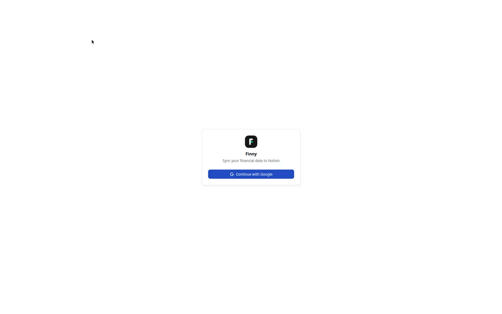
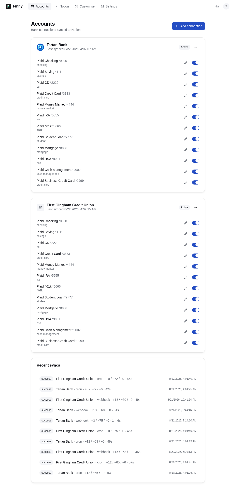
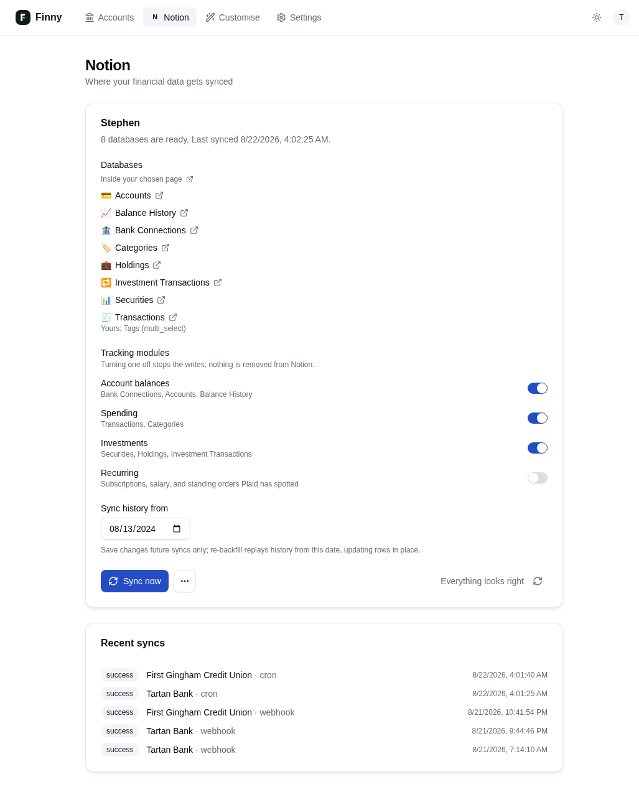
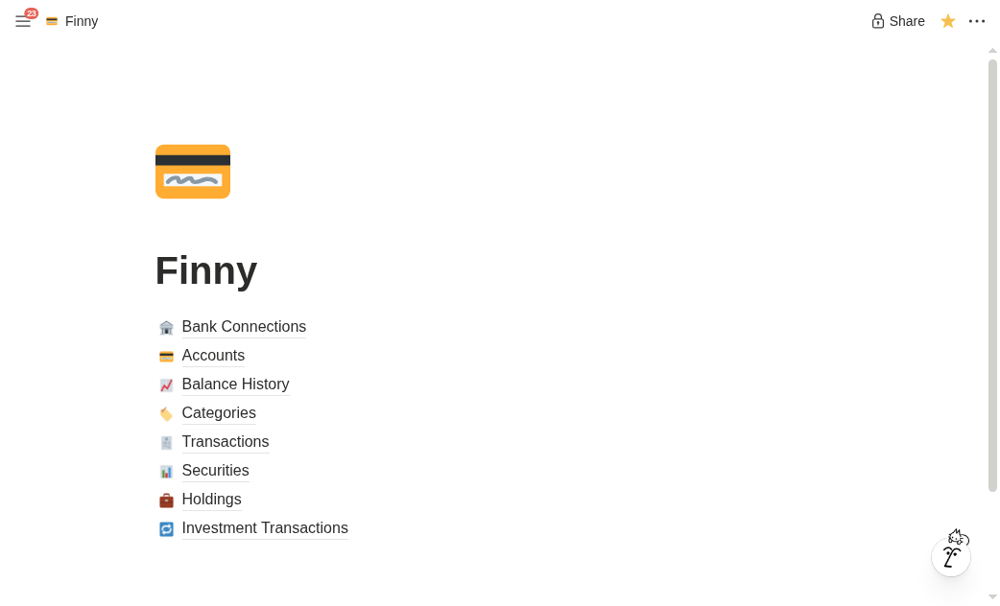
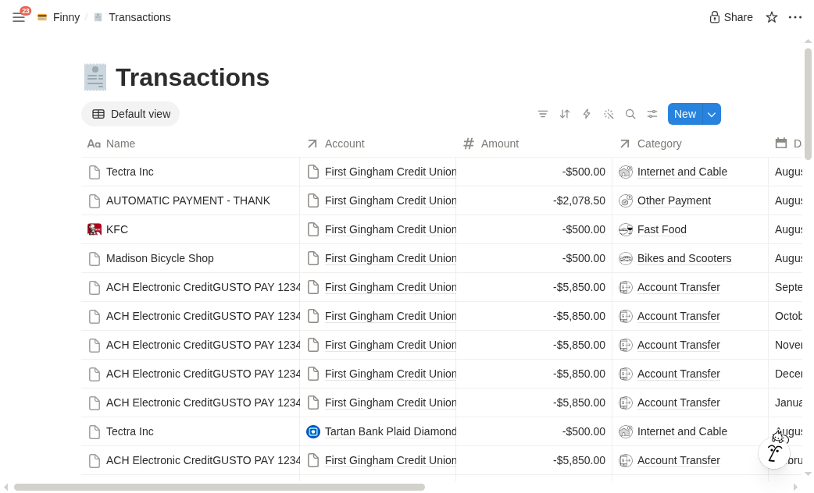
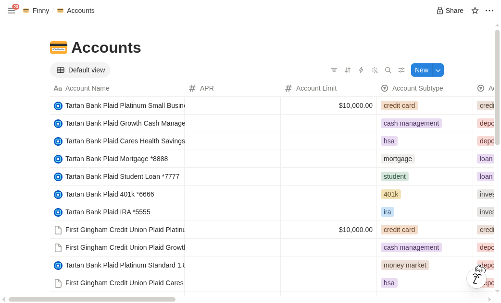

# Finny

Plaid → Notion. Connect a bank, pick a page, Finny creates the databases and
keeps them current. One-way, webhook-driven, rows update in place.

For anyone who wants a ledger in Notion they already know how to query — and
anyone standing up their own instance. The running app at
[finnys.vercel.app](https://finnys.vercel.app) is invite-only.

Amounts, merchants, balances, and transaction dates never rest in Convex.
Tokens, cursors, and an opaque providerId → Notion page id map do.

Vite + React frontend; [Convex](https://convex.dev) for auth, config, and the
sync engine. Notion property names live in
[`convex/notionSchemas.ts`](convex/notionSchemas.ts).

| | |
| ---: | --- |
| Sign-in |  |
| Accounts |  |
| Destination |  |
| Notion home |  |
| Transactions |  |
| Notion accounts |  |

## How it works

Plaid fires a webhook → Convex acks `/plaid/webhook` and runs a sync → Notion
pages are created or patched. A daily sweep at 11:00 UTC takes balance
snapshots and catches webhooks that never arrived. **Sync now** is the same
run, by hand.

What lands in Notion depends on the modules you turn on:

| Module | Databases |
|---|---|
| Always | Bank Connections, Accounts |
| Account balances | Balance History |
| Spending | Transactions, Categories |
| Investments | Securities, Holdings, Investment Transactions |
| Recurring | Recurring streams Plaid has spotted |

Edits to Finny-owned properties in Notion get overwritten on the next sync.
Add your own columns; those stay. Rules on **Customise** (category, rename,
hide, your columns) run in the sync pass-through — there is no stored
transaction to re-apply against later.

A broken bank gets a comment on its Notion row, which is how you find out
without opening the app. That needs the integration's *Insert comments*
capability; without it everything else still works.

## Set up your own instance

You need Node 20+, a [Convex](https://dashboard.convex.dev) account, a
Google Cloud OAuth client, a [Plaid](https://dashboard.plaid.com) account
(Sandbox is free; Trial is 10 production Items, lifetime — deleting one
does not refund the slot), and a **public** [Notion
integration](https://www.notion.so/profile/integrations).

### 1. Convex

```bash
npm install
npx convex dev
```

Interactive the first time: login, project picker, writes `.env.local`
(`CONVEX_DEPLOYMENT`, `VITE_CONVEX_URL`) and `convex/_generated/`. After
that, `npm run dev` starts it with the app.

Two URLs you'll use below:

- API: `https://<deployment>.convex.cloud`
- HTTP: `https://<deployment>.convex.site` (OAuth + webhooks)

### 2. Auth + Google

```bash
npx @convex-dev/auth
```

Accept the defaults (`JWT_PRIVATE_KEY`, `JWKS`, `SITE_URL`). Dev origin is
pinned to port 3466 — FINN on a phone keypad — in
[vite.config.ts](vite.config.ts):

```bash
npx convex env set SITE_URL http://localhost:3466
```

Google Cloud Console → Credentials → OAuth client ID → Web application.
Redirect URI uses **.site**, not .cloud:

```
https://<deployment>.convex.site/api/auth/callback/google
```

```bash
npx convex env set AUTH_GOOGLE_ID <client-id>
npx convex env set AUTH_GOOGLE_SECRET <client-secret>
```

### 3. Plaid

From the [Keys page](https://dashboard.plaid.com/developers/keys):

```bash
npx convex env set PLAID_CLIENT_ID <client-id>
npx convex env set PLAID_SECRET <sandbox-secret>
npx convex env set PLAID_ENV sandbox
```

Webhooks are registered per connection at
`https://<deployment>.convex.site/plaid/webhook` (JWT-verified).

### 4. Notion

Public integration. Redirect URI:

```
https://<deployment>.convex.site/notion/oauth/callback
```

```bash
npx convex env set NOTION_CLIENT_ID <client-id>
npx convex env set NOTION_CLIENT_SECRET <client-secret>
```

Leave *Insert comments* on. Finny comments on a bank's row when it breaks
or comes back. Without the capability the comment is skipped.

### 5. Access password

Google sign-in is open, so a shared password gates every Plaid/Notion
action. Three wrong guesses ban that IP for 24 hours (the `accessAttempts`
row expires; delete it to unban sooner).

```bash
npx convex env set ACCESS_PASSWORD <password-you-share-with-users>
```

Without it, sign-in works but redeeming returns "unconfigured" (503).

### 6. Local shortcuts (optional)

**Skip Google.** Same secret on the deployment and in `.env.local`
(gitignored; never set in Vercel):

```bash
npx convex env set TEST_LOGIN_SECRET "$(openssl rand -hex 24)"
```

`VITE_TEST_LOGIN_SECRET=…` in `.env.local`. A "Continue as tester" button
logs you in as `test@wustep.me`, already past the access password.
Deployed builds have no copy of the secret, so the button is absent and
the backend rejects the provider.

**Sandbox from localhost while prod is production.** Add the Sandbox
secret:

```bash
npx convex env set PLAID_SANDBOX_SECRET <sandbox-secret>
```

Links started on `localhost` then use Sandbox (`user_good` / `pass_good`).
Each connection records its `plaidEnv`; later calls reuse it. Without this
secret, local links burn real production Items.

### 7. Run

```bash
npm run dev
```

`convex dev` + Vite in one terminal. First checkout: do step 1 once — that
login is interactive. Split them with `npm run convex:dev` and
`npm run dev:app` if you want.

Open http://localhost:3466 → Google → access password → **Add connection**
(Sandbox: `user_good` / `pass_good`) → **Notion → Connect Notion** → pick
a page, modules, and start date → **Create databases**. The first backfill
starts on its own (default window: two years).

## Deploy to Vercel

1. Import the repo at [vercel.com/new](https://vercel.com/new). Vite is
   auto-detected; [vercel.json](vercel.json) rewrites the SPA.
2. Set `VITE_CONVEX_URL` to `https://<deployment>.convex.cloud`.
3. Allowlist the origin:

```bash
npx convex env set APP_ORIGINS https://<your-app>.vercel.app
```

Pushes to `main` auto-deploy. The same Convex deployment can serve
localhost and production. For a real split, `npx convex deploy` a prod
deployment and copy the env vars — register its `.convex.site` URLs with
Google and Notion.

## Real banks (Plaid production)

1. Unlock Production in the Plaid dashboard (Trial is usually auto-approved;
   **10 production Items lifetime**). Finish the app branding profile.
2. Allowed redirect URIs (Developers → API), required for OAuth banks like
   Chase — activation can take a few days:

```
https://<your-app>.vercel.app/plaid-oauth
http://localhost:3466/plaid-oauth
```

3. Remove sandbox connections in the app, then:

```bash
npx convex env set PLAID_SECRET <production-secret>
npx convex env set PLAID_ENV production
```

## Environment variables

Set on the Convex deployment with `npx convex env set KEY value` unless
noted. The typed list lives in
[`convex/convex.config.ts`](convex/convex.config.ts).

| Variable | Purpose |
|---|---|
| `SITE_URL` | App origin in dev; base for auth redirects |
| `JWT_PRIVATE_KEY`, `JWKS` | Convex Auth token signing (`npx @convex-dev/auth`) |
| `AUTH_GOOGLE_ID`, `AUTH_GOOGLE_SECRET` | Google OAuth client |
| `PLAID_CLIENT_ID`, `PLAID_SECRET`, `PLAID_ENV` | Plaid (`sandbox` or `production`) |
| `NOTION_CLIENT_ID`, `NOTION_CLIENT_SECRET` | Notion public integration |
| `ACCESS_PASSWORD` | Shared invite password. Optional to deploy; required to use the app |
| `TEST_LOGIN_SECRET` | Optional; local "Continue as tester" |
| `TEST_LOGIN_EMAIL` | Optional; test identity (default `test@wustep.me`) |
| `PLAID_SANDBOX_SECRET` | Optional; localhost → Sandbox while prod stays production |
| `VITE_TEST_LOGIN_SECRET` | **`.env.local` only** — must match `TEST_LOGIN_SECRET` |
| `APP_ORIGINS` | Optional extra origins (your Vercel URL) |
| `VITE_CONVEX_URL` | **Vercel / `.env.local`**: the deployment's `.convex.cloud` URL |
